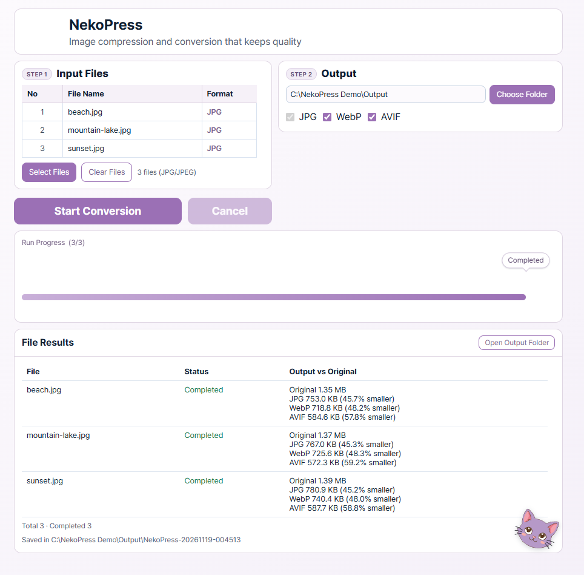

<p align="center"></p>
<h1 align="center">NekoPress</h1>
<p align="center">Make JPG and PNG images smaller on Windows, and save WebP and AVIF copies at the same time.</p>



## What it does

- **JPG** → smaller JPG, plus WebP and AVIF
- **PNG** → smaller PNG, plus WebP and AVIF
- WebP and AVIF can be turned off. There are no quality sliders to set: drop in your images and start.

## Why NekoPress

- **Offline and private.** Everything happens on your PC. NekoPress does not connect to the internet and collects nothing: no account, no analytics, no update checks. Location and camera details (EXIF, GPS) and other metadata are removed from the converted files, while orientation, colors and transparency are kept.
- **Safe with your files.** Your originals are never changed or overwritten. Each run saves into a new folder, every file is checked before it is saved, and a result is kept only if it is smaller than the original.
- **Consistent quality.** One set of quality settings, chosen by comparing the results on real photos and graphics. PNG is compressed losslessly, with no color reduction. AVIF uses 10-bit color by default to avoid banding in smooth gradients. The same image gives byte-for-byte the same files on a 4-thread desktop, an 8-thread laptop and a 24-thread desktop.
- **Fast.** Several images are converted at once across your CPU threads, and the work is planned around your PC's memory. In our measurements this was about 1.7× faster than converting one image at a time on 4-core PCs and about 3.9× on a 24-thread PC. Conversion keeps full speed while the window is in the background.
- **Built with security in mind.** The bundled encoders are checked against known SHA-256 hashes and locked while NekoPress runs, the app checks its own code at startup and refuses to run if it was modified, only the image decoders it needs are enabled, and the window runs in a sandbox.
- **Portable.** One EXE. No installation and no administrator rights.

## Download

1. Download `NekoPress-x.y.z-portable.exe` from [Releases](../../releases/latest). This repository is the only official source.
2. Optional: check the file in PowerShell and compare the result with the SHA-256 in the release notes.
   ```powershell
   Get-FileHash .\NekoPress-x.y.z-portable.exe
   ```
3. Run the EXE.

## First run

- NekoPress is not code-signed, so Windows may show "Windows protected your PC". If you downloaded it from this repository and the SHA-256 matches, choose **More info → Run anyway**.
- On PCs where Smart App Control is on, Windows may block NekoPress.
- Each start unpacks the app to a temporary folder (a few seconds). It is removed when NekoPress closes.

## Requirements

|  | Minimum | Recommended |
|---|---|---|
| Windows | 10 (64-bit) | 11 (64-bit) |
| CPU | 4 cores / 4 threads | 8 threads or more |
| Memory | 8 GB | 16 GB or more |
| Free disk space | 1 GB | 2 GB on an SSD |
| Screen | 1280×720 | 1920×1080 |

**How many CPU threads does it actually use?** Threads busy while converting test images (19 JPG, 34 PNG) with the default settings (WebP and AVIF on). The 4- and 8-thread figures were measured by limiting a 24-thread CPU to that many threads.

| CPU threads | Converting JPG: typical / peak | Converting PNG: typical / peak |
|---|---|---|
| 4 | 4 / 4 | 3 / 4 |
| 8 | 4 / 8 | 3 / 8 |
| 24 | 21 / 24 | 23 / 24 |

"Typical" is the median: at least that many threads were busy for half of the conversion time or more. Near the end of a job, when little work is left, it drops to 1–2. WebP encoding can use only one thread per image, so NekoPress converts several images at once to keep the threads busy.

## Good to know

- One job converts either JPG or PNG files, up to 1,000 files.
- Animated PNGs and JPGs that contain more than one picture (for example 3D photos) are not supported. HDR gain maps in photos are not kept.
- Settings and statistics are stored in `%APPDATA%\NekoPress` (no file names). Delete that folder to remove them.
- The **Feedback on GitHub** button in the app opens this repository's Issues page in your web browser. NekoPress itself sends nothing.

## License

NekoPress is free to use and is provided as is, without warranty. See [TERMS.md](TERMS.md).
NekoPress includes third-party software under its own licenses: see `THIRD-PARTY-NOTICES.txt` in each release, or in the app click the cat at the top, then **More → View Licenses & Notices**. The source code of the components under the LGPL and the MPL is attached to each release as `NekoPress-x.y.z-third-party-sources.zip`.

## Feedback

Found a problem or have a suggestion? Open an issue on the [Issues](../../issues) page. In the app, click the cat at the top, then **More → Feedback on GitHub**.

## Security

Please report security problems privately. See [SECURITY.md](SECURITY.md).
